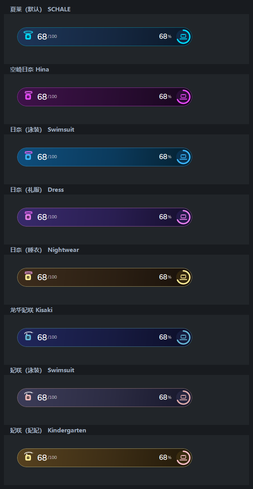
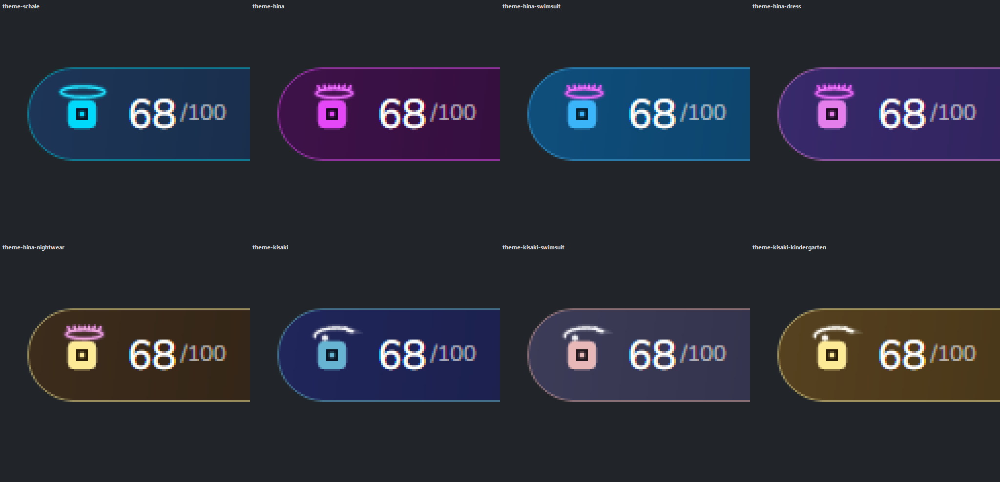
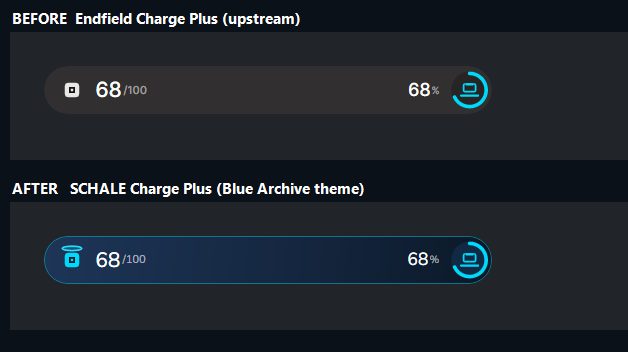

# SCHALE Charge Plus · Blue Archive-style Status HUD

> A desktop status HUD redrawn in the visual language of *Blue Archive*: deep-grey plate, signature cyan, character halos.
> Eight switchable character skins. The halo shape belongs to the character, its colour follows the outfit.

[简体中文](README.md) · **English**　｜　**Windows 10 / 11 · x64 / x86 / ARM64**



---

## What this is

SCHALE Charge Plus (**ECP**) is a status HUD that lives on your desktop. CPU, GPU, memory, disk, network, time, DeepSeek API balance and your own HTTP/JSON endpoints can all be composed into a single capsule across the top of the screen — summoned on demand, dismissed on demand, or cycled automatically.

It descends from [QinAnze/zmd-charge](https://github.com/QinAnze/zmd-charge) via [GlacierGlimmer/zmd-charge-plus](https://github.com/GlacierGlimmer/zmd-charge-plus). **This repository does exactly one thing: it redraws the entire interface in *Blue Archive*'s style and adds a per-character-outfit theme layer.** Features, the variable library, the profile system and the animation timelines are all inherited unchanged.

---

## Themes

Settings → **Display & Position → Character theme**. Switching previews live; hitting **Save and apply** persists it.

| Theme | Palette source | Halo shape |
| :-- | :-- | :-- |
| SCHALE (default) | `#212529` plate + `#00D9FA` cyan | plain flattened ring |
| Sorasaki Hina | sampled from key art: halo magenta `#E448F6`, deep purple `#3C0048` | spiked crown |
| Hina (Swimsuit) | `#1EAAF0` sky blue + `#D2E6F0` pale blue + `#F0B4D2` pink | spiked crown |
| Hina (Dress) | `#E47EEA` pale violet + `#463C78` indigo | spiked crown |
| Hina (Nightwear) | `#FCEA96` cream + `#F0B4C8` pink + `#241A2E` dark | spiked crown |
| Ryuge Kisaki | `#1E244E` deep indigo + `#66AECC` teal + `#CCD2D2` silver | brushed cloud-scroll crescent |
| Kisaki (Swimsuit) | `#464664` blue-violet + `#DCAAAA` coral + `#EAEAF0` near-white | brushed cloud-scroll crescent |
| Kisaki (Kindergarten) | `#FCEA96` sun hat + `#FABEC8` sakura + `#E4A854` amber | brushed cloud-scroll crescent |

These are not one hue rotated seven times. The key colours of each outfit were sampled from pixel statistics of that outfit's official key art — saturated-colour mode plus highlight and shadow samples. That is why the swimsuit reads blue and the nightwear reads cream, instead of three darker shades of purple.

The halo shape is bound to the character, not the outfit: all four Hina forms share the spiked crown, all three Kisaki forms share the cloud-scroll crescent. That is how the source material defines them, and it is the single symbol that lets you identify the character at a glance.



---

## What changed visually

- **Palette**: taken from SchaleDB's official dark-theme design tokens — `#212529` plate, `#00D9FA` signature cyan, `#006BFF` accent — replacing the original yellow-green Endfield scheme.
- **Halo**: a flattened glowing ring sits above the HUD's icon plate, three stacked strokes giving it its bloom. Both the full and the simple animation timelines light it.
- **Capsule**: `LinearGradientBrush` deep-sea gradient with a cyan edge and outer glow, recoloured live by the active theme.
- **Icons**: the application and tray icons are redrawn as a cyan halo over a dark character plate. The ICO covers 16 / 20 / 24 / 32 / 40 / 48 / 64 / 128 / 256 px — the aperture is still legible at the smallest size.
- **Typeface**: HUD numerals and titles use **Nunito Sans** (SchaleDB's UI face), instanced from the upstream variable font into four static weights (400/500/600/700). CJK falls back to Microsoft YaHei / PingFang.
- **Controls**: the Avalonia Fluent `SystemControl*` / `ComboBox*` / `ListBox*` resource keys are overridden, so dropdowns, lists and buttons no longer leak the default warm-grey dark surfaces. The language picker's list background needed a separate fix.
- **Identity**: the display name is SCHALE Charge Plus throughout; the default tagline reads `/// SCHALE MONITOR`.

The assembly name, root namespace, `avares://` resource paths and executable filename all remain `EndfieldChargePlus`. Renaming them would break existing configs, startup entries and update channels for no visible gain.



---

## Download and first run

Grab the portable ZIP for your architecture from this repository's [Releases](https://github.com/chenmoulaile/schale-charge-plus/releases):

| Architecture | File | For |
| :-- | :-- | :-- |
| x64 | `SCHALE-Charge-Plus-v0.1.2-ba-win-x64-portable.zip` | nearly every Windows 10 / 11 machine |
| x86 | `SCHALE-Charge-Plus-v0.1.2-ba-win-x86-portable.zip` | 32-bit systems |
| ARM64 | `SCHALE-Charge-Plus-v0.1.2-ba-win-arm64-portable.zip` | Windows on ARM |

Extract and run `EndfieldChargePlus.exe`. No installer, no separately installed .NET runtime. `SHA256SUMS.txt` ships alongside for verification:

```powershell
Get-FileHash .\SCHALE-Charge-Plus-v0.1.2-ba-win-x64-portable.zip -Algorithm SHA256
```

**First run:**

1. Launch `EndfieldChargePlus.exe` — it parks itself in the system tray.
2. Tray menu → **Settings**.
3. Under "Display & Position", pick the monitor, the HUD position, the display mode — and a character theme while you are there.
4. Under "HUD content", choose a built-in profile or build your own, then hit **Preview**.
5. Hit **Save and apply**. Settings persist across restarts.

The first launch uses the "System - Memory" profile. The UI language follows your system locale: Chinese locales get Simplified Chinese, everything else gets English.

> The Microsoft Store, Linux, macOS and Android editions are published from the upstream repositories and are not distributed here. This repository ships Windows portable builds only.

---

## Building it yourself

Windows plus the [.NET 8 SDK](https://dotnet.microsoft.com/download/dotnet/8.0).

```powershell
# compile
dotnet build EndfieldChargePlus.csproj -c Release

# packaged self-contained single file for x64
./scripts/package-windows.ps1 -Runtime win-x64
```

Swap `win-x64` for `win-x86` or `win-arm64` for the other architectures. Output lands in `publish/<runtime>-portable/` as a single EXE.

The FPS collector picks the bundled x64 or ARM64 helper to match the system architecture.

---

## Features

Identical to upstream. Only the parts you will actually touch are listed here.

| Feature | Notes |
| :-- | :-- |
| **Two display modes** | With "always visible" off, the HUD appears on an event or pointer summon and retracts itself; with it on, the current profile stays on screen |
| **Topmost / desktop layer** | A persistent HUD can stay topmost or sit on the desktop layer; it is click-through, so it never blocks your work |
| **Pointer summon** | Move the pointer to the top centre of the target monitor to show the active non-battery profile |
| **Multi-monitor and placement** | Choose the monitor, a nine-cell preset or custom X/Y, with adjustable scale and opacity |
| **Profiles and animation** | Built-in battery / CPU / GPU / memory / disk / network / time / DeepSeek profiles; full and simple animation modes |
| **Auto cycle** | Loop through a custom queue with its own interval and transition animation |
| **Variable library** | Built-in variables, 17 per-drive templates generated from the drives actually present, and fan variables built from the sensors actually detected |
| **Composition** | Title, primary and secondary values, percentage ring and both icons are all template-driven, with formatting, expressions and conditional colour rules |
| **Network probe** | Probe an IPv4 address, IPv6 address or hostname on a chosen port over ICMP, TCP or UDP |
| **DeepSeek API** | Supply your own key to show balance, peak/off-peak state, period progress and countdown |
| **HTTP / JSON sources** | Configure URL, headers, refresh interval and field mapping to pipe your own endpoint into the HUD |

```text
{cpu.usage|0}                CPU usage
{memory.used_bytes|gb:1}     memory used (GB)
{network.download_bps|speed} network download speed
{deepseek.balance|0.00}      DeepSeek API balance
```

The numbers are not simulated. When a source is unreachable the HUD reports it as unavailable rather than fabricating a zero. The full key list lives in the in-app variable library.

---

## Verification

Before packaging, the repository's own regression suites were run on this machine (Windows 10.0.19041, .NET SDK 8.0.426):

| Suite | Result |
| :-- | :-- |
| `--appearance` | **PASS** — 33 appearance and language checks |
| `--layers` | **PASS** — 104 multi-HUD layer checks |
| `--localization` | resource layer **PASS** — 21 locales × 1728 messages; the GUI layer aborts on the `ar-SA` `SaveBtn` visibility assertion |
| `--rendering` | aborts on the transparent-pixel assertion |

The latter two are not regressions from this work. Running the same suites on the untouched upstream baseline `GlacierGlimmer/zmd-charge-plus`, on the same machine, aborts at exactly the same points (`--localization` at `ar-SA SaveBtn`, `--rendering` at `Real desktop pixels outside both HUD capsules stay transparent`). Those assertions depend on the specific desktop session and DPI environment, and do not hold here. This is stated plainly rather than listing only the green rows.

All three architecture builds were launched for real; the log records `SCHALE Charge Plus process started. Version=0.1.2`.

---

## Credits, licence and disclaimer

- Upstream HUD: [QinAnze/zmd-charge](https://github.com/QinAnze/zmd-charge), by **QinAnze**.
- Derivative baseline: [GlacierGlimmer/zmd-charge-plus](https://github.com/GlacierGlimmer/zmd-charge-plus), by **GlacierGlimmer**.
- The code and theme work added here are released under the [MIT License](LICENSE). Upstream attribution is preserved in full in [NOTICE.md](NOTICE.md).
- **Nunito Sans** is licensed under the SIL Open Font License 1.1; the full text is at `Assets/Fonts/NunitoSans-OFL.txt`.
- **Blue Archive** characters, names and artwork belong to NEXON Games and its publishers. This is an unofficial community project with no affiliation, authorisation or endorsement. The repository contains no original game artwork — only colour values sampled from it and halo geometry drawn from scratch.

Data handling is described in [PRIVACY.md](PRIVACY.md).

---

## Finding upstream

To return to the unthemed original, or to get Linux / macOS / Android builds:

- Unthemed Windows original: [GlacierGlimmer/zmd-charge-plus](https://github.com/GlacierGlimmer/zmd-charge-plus)
- Linux: [zmd-charge-plus-for-linux](https://github.com/GlacierGlimmer/zmd-charge-plus-for-linux)
- macOS: [zmd-charge-plus-for-macos](https://github.com/GlacierGlimmer/zmd-charge-plus-for-macos)
- Android: [zmd-charge-plus-for-android](https://github.com/GlacierGlimmer/zmd-charge-plus-for-android)
